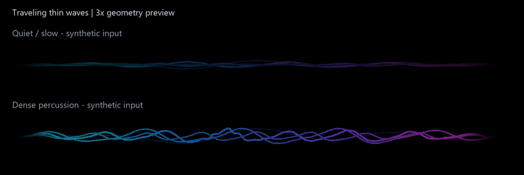

# Traveling micro-wave refinement

This refinement changes the motion of three thin lines: mid, percussion/micro,
and one high-detail line. Compact shows its existing micro line; Expanded shows
all three. The primary bass ribbon, secondary ribbon, other supporting lines,
orb, notch, metadata, playback timeline and seek commands retain their behavior.
The WASAPI capture and FFT/detector logic are unchanged.

## Continuous propagation

`TravelingWaves` owns three unwrapped phase clocks, separate from audio-input
blending and playback progress. Each line evaluates `sin(k*x - phase + offset)`
plus a small co-propagating harmonic. Positive phase velocity moves crests right
while each fixed timeline coordinate moves vertically. Static reference curvature
is retained at reduced weight on these lines, so it no longer dominates the
traveling pattern. The other four layer geometry formulas remain unchanged.

Velocity follows smoothed mid/high features, band onsets, measured onset density
and short-lived activity. It accelerates with a 160 ms time constant and releases
over 360 ms. The phase uses the analytic integral of that smoothed velocity,
rather than a frame-dependent Euler increment. Onsets never reset phase, and
capture blending changes velocity/amplitude rather than multiplying the phase.
Pause freezes clocks; reduced motion keeps the existing capture/redraw gate.
Capture loss settles to slow procedural motion without simulated beat events.

| Line | Cycles across width | Angular velocity at normal animation speed |
|---|---:|---:|
| Mid | 5 | 1.6–4.2 rad/s |
| Micro | 8 | 3.0–8.4 rad/s |
| High detail | 9 | 4.0–10.4 rad/s |

Amplitude, wavelength and velocity have separate tuning parameters in
`modules/traveling_wave.rs`. Wavelength stays fixed during a passage; recent
onset density gently increases harmonic definition instead of changing `k*x`
and accidentally pulling peaks backward. Both angular velocities and actual
crest speeds differ. At a 268 px timeline, fully active upper-bound speeds are
approximately 35.8 / 44.8 / 49.3 logical px/s. The existing `animation_speed`
scales the clocks. No additional settings panel or configuration keys are added.
The fastest line loses at most 10% opacity to keep the motion restrained.

## Packets and smooth paths

Existing measured transient events still create local packets. Their envelope
and carrier now both propagate right; directions no longer alternate. Packet
velocity is fixed at birth from onset spacing (0.22–0.34 timeline widths/s), so
it does not jerk during its short lifetime. The carrier advances slightly faster
than its smooth local envelope. At most four packets coexist, and they deform
only the percussion line rather than appearing identically on several lines.
The worker's eight-event transport history and 45 ms detector guard are retained.

The three traveling paths use shape-preserving cubic interpolation. Controls
stay within each segment's vertical sample range, and their one-third/two-third
x positions keep the horizontal parameter linear. This removes visible polygon
corners without overshooting sampled extrema. The original frame scissor, native
horizontal gradient fading, stroke limits, and 14/25 logical px slots still apply.
Played and remaining regions draw the same prepared path. The primary curve used
by the orb and its progress coordinate is unchanged.

Rendering reuses the existing 96 samples and fixed packet storage. There is no
additional timer, capture worker, FFT, per-frame audio buffer, or CPU blur.

## Verification and preview

Formatting, compilation, strict Clippy and 31 tests pass. An initial parallel
compile exhausted host memory; rerunning with `-j 1` succeeded. Tests cover:

- Rightward translation of the actual carrier, not just changing amplitude.
- Continuous phase and bounded/smoothed velocity across audio/capture changes.
- Matching phase integration at 30 and 120 fps; independent wavelength and speed.
- Only the three thin paths change when their clocks advance, while bass geometry
  and all sample x coordinates remain identical.
- Cubic controls stay inside local extrema; existing 14/25 px geometry and orb
  fitting, timeline/seek, reduced-motion, pause, silence and audio tests pass.
- Packet bounds, measured density, rightward propagation and natural expiry.

A four-second headless preview uses production renderer points with synthetic
quiet/slow and dense-percussion feature streams. It magnifies the waveform 3x;
the primary ribbon is a faint reference and the playback head is omitted.
It is not a recording of the desktop or a comparison of real songs.



Measured steady angular velocities from those synthetic inputs:

| Input | Mid | Micro | High |
|---|---:|---:|---:|
| Quiet / slow | 1.737 | 3.066 | 4.193 |
| Dense percussion | 3.698 | 7.242 | 8.692 |

An eight-second read-only live system-output probe received 243 snapshots and
77 spectral transient events. Observed angular velocities were mid 2.420–3.081,
micro 4.422–6.208, and high 5.882–7.850 rad/s. These are measured parameter ranges
from the current system mix, not classified drum counts or desktop visual
acceptance. Songs/genres were not selected and playback was not controlled.
A controlled real quiet-versus-dense passage comparison remains user QA.

Debug renderer logs under `rimflux::waveform_bands=debug` now include velocities,
continuous phases and onset density. The debug-only `--audio-probe` also reports
velocity ranges; the normal capture lifecycle is unaffected.

Reproduce the synthetic artifact:

```powershell
cargo run --locked --offline -j 1 --example traveling_preview
python examples/traveling_preview.py
```

The renderer requires no GPU for this export. Pillow is a development-only
dependency for converting the CSV geometry into GIF/PNG. The finite GIF has no
loop extension, which avoids introducing a fake phase reset at the clip boundary.
No captured PCM or user screen content is saved.

Modified sources: `src/modules/traveling_wave.rs`, `src/modules/mod.rs`,
`src/modules/waveform.rs`, `src/modules/waveform_reactivity.rs`,
`src/core/state.rs`, `src/ui/waveform.rs`; debug diagnostics in
`src/platform/windows_audio.rs`; tests in `tests/traveling_wave.rs`; preview
export/render scripts in `examples/traveling_preview.rs` and `.py`; this note,
`README.md`, and the Part 3.2 link.
